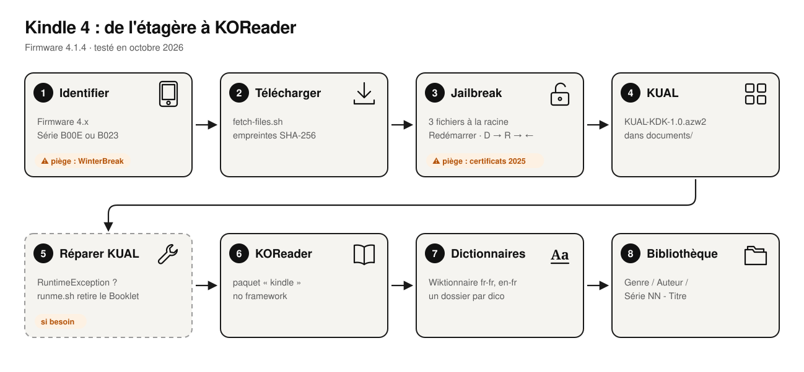

<div align="center">

# kindle4-revival

### Redonner vie à une Kindle 4 de 2011, en 2026.

Jailbreak, KOReader, dictionnaires hors ligne et bibliothèque rangée sur la Kindle 4 sans écran tactile (firmware 4.x).<br>Chaque étape testée en octobre 2026, chaque fichier figé, chaque piège expliqué.

[](#)
[](https://github.com/koreader/koreader/releases/tag/v2026.07.1)
[](#)
[](LICENSE)

**[Lire le guide](articles/kindle-4-jailbreak-2026.fr.md)** · [Read the guide in English](articles/kindle-4-jailbreak-2026.en.md) · [English version of this page](README.md)

<picture>
  <source media="(prefers-color-scheme: dark)" srcset="docs/img/steps-fr-dark.svg">
  
</picture>

</div>

## La version courte

| # | Étape | Détail |
|---|---|---|
| 1 | Vérifier que le firmware est en **4.x** et que le numéro de série commence par **B00E** ou **B023** | sinon, ce n'est pas le bon guide |
| 2 | `./scripts/fetch-files.sh` | télécharge tous les fichiers ci-dessous et vérifie leur SHA-256 |
| 3 | Copier `data.tar.gz`, `ENABLE_DIAGS`, `diagnostic_logs/` de `K4-Jailbreak.zip` à la racine, redémarrer, puis **D → R → gauche** | « You are Jailbroken » apparaît |
| 4 | Copier `KUAL-KDK-1.0.azw2` dans `documents/` | il s'ouvre comme un livre |
| 5 | KUAL plante avec une *RuntimeException* ? | lancer [`tools/fix-kual-booklet`](tools/fix-kual-booklet/runme.sh) |
| 6 | Décompresser `koreader-kindle-*.zip` à la racine | KUAL → KOReader → Start KOReader (no framework) |
| 7 | Décompresser les dictionnaires dans `koreader/data/dict/<nom>/` | un dossier par dictionnaire |
| 8 | Ranger ses EPUB avec [`tools/organize-library`](tools/organize-library/) | puis régler l'affichage de KOReader sur les noms de fichiers |

## Contenu

```
articles/           le guide complet, en français et en anglais
docs/img/           schéma des étapes (scripts/make-diagram.py) et captures de terminal (docs/transcripts/ + scripts/term2svg.py)
files/              fichiers tiers, téléchargés par scripts/fetch-files.sh (non versionnés)
scripts/            fetch-files.sh, term2svg.py, make-diagram.py
tools/
  diagnostic/       rapport système en lecture seule, exécuté par le jailbreak (runme.sh)
  fix-kual-booklet/ supprime un KUALBooklet.jar qui casse KUAL sur Kindle 4
  kual-screenshot/  extension KUAL de capture d'écran, et son convertisseur PNG
  organize-library/ range des EPUB en Genre/Auteur/Série NN - Titre.epub
```

## Fichiers utilisés

| Fichier | Version | Licence | Source |
|---|---|---|---|
| K4-Jailbreak.zip | v1.0.0 (29/06/2026) | non précisée | [KindleModding/K4-Jailbreak](https://github.com/KindleModding/K4-Jailbreak) |
| KUAL-KDK-1.0.azw2 | v2.7.37 (19/04/2025) | MIT / Apache-2.0 | [MobileRead, snapshots de NiLuJe](https://www.mobileread.com/forums/showthread.php?t=225030) |
| koreader-kindle-v2026.07.1.zip | v2026.07.1 | AGPL-3.0 | [koreader/koreader](https://github.com/koreader/koreader) |
| fr-fr.tar.zst, en-fr.tar.zst | version 20261016 | GPL-3.0 (outil), CC BY-SA (données Wiktionnaire) | [xxyzz/wiktionary_stardict](https://github.com/xxyzz/wiktionary_stardict) |

Ces fichiers ne sont pas versionnés : `scripts/fetch-files.sh` les télécharge à la source et vérifie leurs empreintes. Tout le mérite revient à leurs auteurs : NiLuJe et la communauté MobileRead, KindleModding, et l'équipe KOReader.

## Avertissement

Un jailbreak modifie le système de l'appareil. Le risque est faible avec cette méthode, mais pas nul. Faites-le sur un appareil qui vous appartient. Rien ici ne contourne les DRM : KOReader n'ouvre que les livres sans DRM.

## Licence

[GPL-3.0](LICENSE), avec une condition supplémentaire dans [NOTICE](NOTICE) : toute version diffusée doit conserver la mention *« Based on kindle4-revival by Florent Bertiaux »*. Les fichiers tiers gardent leur propre licence (voir le tableau ci-dessus).

<div align="center">
<br>
<sub>Fait avec une Kindle de quinze ans, beaucoup de patience et le travail de la communauté MobileRead.<br>
Sans lien avec Amazon. Kindle est une marque d’Amazon.com, Inc.</sub>
</div>
