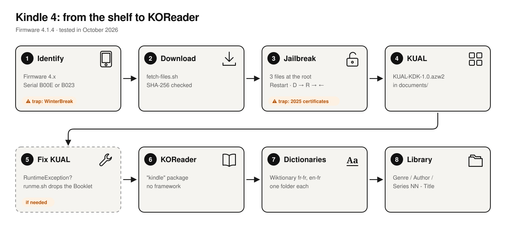

<div align="center">

# kindle4-revival

### Revive a 2011 Kindle 4 in 2026.

Jailbreak, KOReader, offline dictionaries and a tidy library on the non-touch Kindle 4 (firmware 4.x).<br>Tested step by step in October 2026, with the exact files and a fix for each error I ran into.

[](#)
[](https://github.com/koreader/koreader/releases/tag/v2026.07.1)
[](#)
[](LICENSE)

**[Read the guide](articles/kindle-4-jailbreak-2026.en.md)** · [Lire le guide en français](articles/kindle-4-jailbreak-2026.fr.md) · [Version française de cette page](README.fr.md)

<picture>
  <source media="(prefers-color-scheme: dark)" srcset="docs/img/steps-en-dark.svg">
  
</picture>

</div>

## The short version

| # | Step | Details |
|---|---|---|
| 1 | Check the firmware is **4.x** and the serial starts with **B00E** or **B023** | otherwise this is the wrong guide |
| 2 | `./scripts/fetch-files.sh` | downloads every file below and checks its SHA-256 |
| 3 | Copy `data.tar.gz`, `ENABLE_DIAGS`, `diagnostic_logs/` from `K4-Jailbreak.zip` to the Kindle root, restart, then **D → R → left** | "You are Jailbroken" appears |
| 4 | Copy `KUAL-KDK-1.0.azw2` to `documents/` | open it like a book |
| 5 | KUAL crashes with a *RuntimeException*? | run [`tools/fix-kual-booklet`](tools/fix-kual-booklet/runme.sh) |
| 6 | Unzip `koreader-kindle-*.zip` at the Kindle root | KUAL → KOReader → Start KOReader (no framework) |
| 7 | Unpack the dictionaries into `koreader/data/dict/<name>/` | one folder per dictionary |
| 8 | Sort your EPUBs with [`tools/organize-library`](tools/organize-library/) | then set KOReader's display mode to show file names |

## What's in here

```
articles/           the full guide, English and French
docs/img/           step diagram (scripts/make-diagram.py) and terminal captures (docs/transcripts/ + scripts/term2svg.py)
files/              third-party files, downloaded by scripts/fetch-files.sh (not committed)
scripts/            fetch-files.sh, term2svg.py, make-diagram.py
tools/
  diagnostic/       read-only system report, run by the jailbreak as runme.sh
  fix-kual-booklet/ removes a stray KUALBooklet.jar that breaks KUAL on a Kindle 4
  kual-screenshot/  KUAL extension that captures the screen, plus a PNG converter
  organize-library/ sorts EPUBs into Genre/Author/Series NN - Title.epub
```

## Files used

| File | Version | License | Upstream |
|---|---|---|---|
| K4-Jailbreak.zip | v1.0.0 (2026-06-29) | none stated | [KindleModding/K4-Jailbreak](https://github.com/KindleModding/K4-Jailbreak) |
| KUAL-KDK-1.0.azw2 | v2.7.37 (2025-04-19) | MIT / Apache-2.0 | [MobileRead, NiLuJe's snapshots](https://www.mobileread.com/forums/showthread.php?t=225030) |
| koreader-kindle-v2026.07.1.zip | v2026.07.1 | AGPL-3.0 | [koreader/koreader](https://github.com/koreader/koreader) |
| fr-fr.tar.zst, en-fr.tar.zst | release 20261016 | GPL-3.0 (tool), CC BY-SA (Wiktionary data) | [xxyzz/wiktionary_stardict](https://github.com/xxyzz/wiktionary_stardict) |

These files are not committed: `scripts/fetch-files.sh` downloads them from their upstream and verifies the checksums. All credit goes to their authors, NiLuJe and the MobileRead community, KindleModding, and the KOReader team.

## Disclaimer

Jailbreaking modifies the device's system. The risk is low with this method but not zero. Do it on a device you own. Nothing here bypasses DRM: KOReader only opens DRM-free books.

## License

[GPL-3.0](LICENSE), with an additional term in [NOTICE](NOTICE): any distributed version must keep the attribution *“Based on kindle4-revival by Florent Bertiaux”*. Third-party files keep their own licenses (see the table above).

<div align="center">
<br>
<sub>Made with a fifteen-year-old Kindle, a lot of patience and the MobileRead community’s work.<br>
Not affiliated with Amazon. Kindle is a trademark of Amazon.com, Inc.</sub>
</div>
