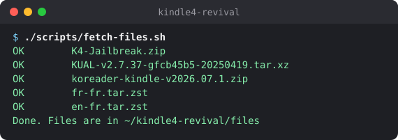
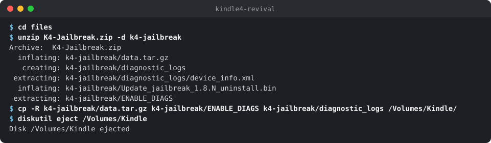
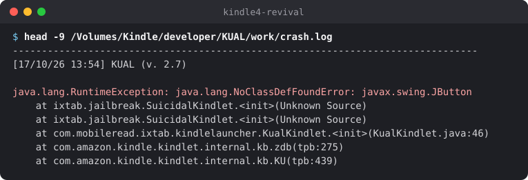
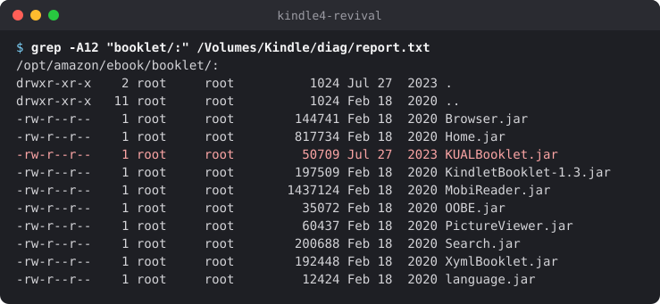
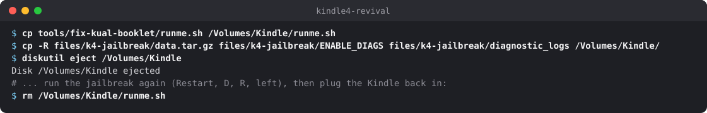
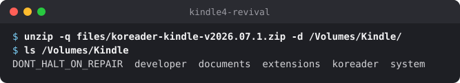
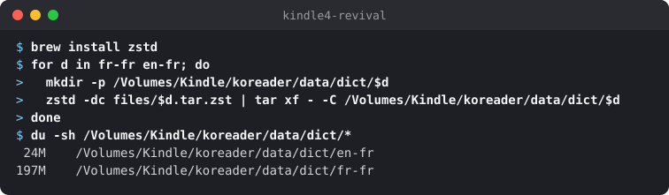
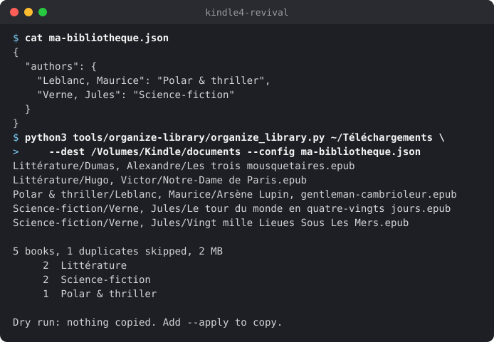

# How I jailbroke my Kindle 4 in 2026 (and why the usual tutorials failed me)

I have a Kindle 4 from 2011. The small one with the five-way pad and no touchscreen. It still holds a charge for weeks, the screen is fine, and Amazon stopped caring about it years ago. I wanted to put KOReader on it.

My first try went nowhere. I followed a popular guide, copied a pile of files over, got an error about the device "not being authorized as a test Kindle", and put the thing back in a drawer. This time I sat down and dug into it properly. Most of what's written online about this model is out of date, so here's what actually worked in October 2026, error messages included.

Every file I used sits in the repository's [`files/`](../files/) folder at the exact version I tested, and my scripts are in [`tools/`](../tools/). If you're in a hurry, the table at the end lists every error I hit and its fix.

---

## Getting the files

One script downloads everything and checks the SHA-256 of each file:



| File | What it is | Upstream |
|---|---|---|
| `K4-Jailbreak.zip` | the jailbreak (v1.0.0, June 2026) | [KindleModding](https://github.com/KindleModding/K4-Jailbreak) |
| `KUAL-KDK-1.0.azw2` | the extension launcher (v2.7.37) | [MobileRead](https://www.mobileread.com/forums/showthread.php?t=225030) |
| `koreader-kindle-v2026.07.1.zip` | the reader | [KOReader](https://github.com/koreader/koreader/releases) |
| `fr-fr.tar.zst`, `en-fr.tar.zst` | Wiktionary dictionaries | [wiktionary_stardict](https://github.com/xxyzz/wiktionary_stardict) |

---

## Check which Kindle you have first

I wasted my first attempt on WinterBreak. It's the jailbreak everyone recommends since late 2024, and it's built for Kindles running firmware 5.x. The Kindle 4 runs firmware 4.x. WinterBreak simply doesn't apply, and nothing tells you so.

To check yours:

- **Firmware**: go to `Menu → Settings` and look at the bottom of the screen. Mine says 4.1.4, which is the last version Amazon ever shipped for this model (2019).
- **Serial number**: `Menu → Settings → Menu → Device Info`. Non-touch Kindle 4 serials start with `B00E` (the silver 2011 model, mine) or `B023` (the black 2012 one).

If your firmware starts with a 5, close this tab and go to [kindlemodding.org](https://kindlemodding.org/).

One upside of owning abandoned hardware: Amazon won't push another update, so nothing will ever undo the jailbreak behind your back.

---

## Why KUAL says "not authorized as a test Kindle"

The community's developer certificates expired in April 2025. Every Kindle jailbroken with an older package carries those dead certificates, and KUAL (the launcher you need for KOReader) gets rejected with:

> "This device is not authorized as a test Kindle by the developer of this item."

NiLuJe, who has maintained most of the Kindle hacking tools on MobileRead for over a decade, published new certificates (`DevCerts-20250419`) and rebuilt KUAL against them (v2.7.37).

In June 2026 the KindleModding folks released **K4-Jailbreak v1.0.0**, which bundles the new certificates. Before running anything, I opened its `data.tar.gz` and read the install script. The keystore it drops on the device has certificates valid until 2099, so that problem goes away for good.

---

## The jailbreak itself

Put the Kindle in airplane mode before you start. Unzip `K4-Jailbreak.zip` and copy `data.tar.gz`, `ENABLE_DIAGS` and the `diagnostic_logs` folder to the root of the Kindle's drive:



Unplug it, then `Menu → Settings → Menu → Restart`. It comes back up on an ugly text screen. That's diagnostics mode, and it's expected. Using the pad, pick `D) Exit, Reboot or Disable Diags`, then `R) Reboot System`, then press **left** to confirm.

You'll see a jailbreak splash with a little ASCII spinner for about ten seconds. The Kindle then reboots by itself, and a document called "You are Jailbroken" shows up in the library.

The zip also contains `Update_jailbreak_1.8.N_uninstall.bin`. Keep it somewhere in case you ever want to undo everything.

---

## KUAL on a Kindle 4 is a document, not an installer

Drop `KUAL-KDK-1.0.azw2` in the Kindle's `documents` folder. Eject, and open it from the library like a book.

Ignore `KUAL-KDK-2.0.azw2` (that one is for the Kindle Touch and later). Ignore the `Update_KUALBooklet_*.bin` packages too. Those are for recent Kindles, and as I found out, they can leave a mess behind.

---

## The RuntimeException that cost me an evening

With fresh certificates in place, KUAL got further and then died with:

> "An error occurred: Main class instantiation threw a RuntimeException."

MobileRead threads say this comes from the Booklet version of KUAL being installed, and suggest running `Update_KUALBooklet_*_uninstall.bin` through "Update Your Kindle". I wanted to know why that would help on a Kindle 4, so I unpacked the uninstaller and read its header. It lists the Kindle 5 family's device IDs only. A Kindle 4 won't accept it.

### Reading the crash log

KUAL writes its own crash log to the USB drive, at `developer/KUAL/work/crash.log`. Mine:



Swing is the UI toolkit of the Kindle Touch. The Kindle 4 doesn't have it, so for some reason KUAL believed it was running on a Touch.

### Finding the culprit

The jailbreak's own README mentions it: if a `runme.sh` sits at the root of the drive, the jailbreak runs it as root when it's done. I wrote a read-only script ([`tools/diagnostic/runme.sh`](../tools/diagnostic/runme.sh)) that lists the system's Java folders into `diag/report.txt`:



There it was. A `KUALBooklet.jar` dated 27 July 2023, left by my own failed attempt years ago with an old copy of MRPI. The Kindle loads every jar in that folder at boot, and the Java jailbreak asks the system class loader first. The Kindle 5 build of KUAL (Swing only) shadowed the one in my `.azw2`.

### Removing it

Same trick, with [`tools/fix-kual-booklet/runme.sh`](../tools/fix-kual-booklet/runme.sh), which backs the file up and deletes it:



KUAL opened on the first try after that. The script leaves `KUALBooklet.jar.bak` and a short `fix-kual-booklet.log` at the root of the drive.

> If KUAL fails on your Kindle 4, read `crash.log` before trying anything else. It names the problem.

---

## KOReader

Get **`koreader-kindle`**. The naming is confusing: `kindle-legacy` sounds right for an old device, but it's for keyboard models (Kindle 2, DX, 3). Unzip it at the root of the Kindle so that `koreader/` and `extensions/` sit at the top level:



Open KUAL and there's a KOReader entry. I use **Start KOReader (no framework)**. It stops Amazon's interface while you read, which frees a good chunk of RAM on a device this old. When you quit KOReader, the stock UI takes around thirty seconds to come back.

Something that tripped me up: quit KOReader before plugging the Kindle into a computer. While KOReader is running, the drive doesn't show up.

KOReader can update itself afterwards over Wi-Fi (the option is called "Update" in its menu).

---

## Dictionaries

KOReader reads StarDict dictionaries from `koreader/data/dict/`. Give each dictionary its own subfolder. I first unpacked two into the same folder and their `res/` directories overwrote each other.

The Wiktionary-based files from [xxyzz/wiktionary_stardict](https://github.com/xxyzz/wiktionary_stardict/releases/latest) are very good. I read mostly in French, so I took `fr-fr` (545,000 entries) plus `en-fr` for English books. For English-only reading, grab `en-en` instead.



Without a touchscreen, looking up a word goes like this: press the keyboard key or the center button to get a cursor, move it onto the word with the pad, press again. The first lookup takes a few seconds while the index loads.

---

## Sorting out the library

I had around 680 EPUBs spread over eight folders: themed collections and batches picked up over the years. Copied as-is, that's an unusable list on a 600 × 800 screen you drive with a joystick.

KOReader has its own file browser and ignores Amazon's collections, so folders are what matter. I went with three levels:

```
documents/
├── Essais & documents/
├── Fantastique & fantasy/
├── Jeunesse/
├── Littérature/
├── Polar & thriller/
└── Science-fiction/
    └── Herbert, Frank/
        ├── Dune 01 - Dune.epub
        ├── Dune 03 - Les enfants de Dune.epub
        └── Les yeux d'Heisenberg.epub
```

Genre first, because on a tired evening I pick a mood before an author. Then `Last, First` so the alphabetical sort works. Series name and number go at the front of the file name, so the volumes line up in order. Any author is two clicks away.

The hard part was the metadata. The same author showed up as "Lee Child", "Child, Lee" and plain "Child". Titles dragged along "(French Edition)", website names and years. About ten books had the title and author fields swapped.

So I wrote [`tools/organize-library/organize_library.py`](../tools/organize-library/). It has no dependencies, reads each EPUB's metadata, rewrites authors as `Last, First`, strips the junk from titles, picks up series numbers, guesses the genre and skips duplicates. It never touches the originals, and by default it only prints what it would do. Here it is on a few public-domain books:



A small JSON file fixes what the guessing gets wrong (an author's genre, a name variant, a stubborn title). Once the plan looks right, run it again with `--apply`.

On my library: 645 books, 31 duplicates skipped, 432 MB. That fits in the Kindle 4's free gigabyte.

One setting matters a lot here. By default KOReader shows the title stored in the metadata, not the file name, so all that cleanup would be invisible. In the file browser, open "Display mode" and pick "Detailed list with cover images and filenames", or "Classic (filename only)" if you want speed on this old CPU. Covers take a while to generate the first time and are cached afterwards.

About DRM: KOReader can't open protected books. A `META-INF/encryption.xml` inside an EPUB doesn't always mean DRM, though. In three of my files it only covered the embedded fonts (Adobe font obfuscation), and they open fine.

---

## Settings I changed

- **Full refresh rate** set to every 6 pages. E-ink ghosting on this panel builds up quickly, and a black flash every few pages clears it.
- **Auto-disable Wi-Fi** (under Network). Battery life on a 2011 Kindle is still great as long as Wi-Fi stays off.
- **Font**: Noto Serif ships with KOReader and looks sharp at 167 ppi. Any `.ttf` you put in `koreader/fonts/` shows up in the font list.
- Long-pressing a typography setting (font size, margins, line spacing) makes it the default for every book. It took me a while to find that.

---

## Getting books on it without a cable

KOReader talks to Calibre directly. In Calibre, click "Connect/share" and start the wireless device connection. On the Kindle, with Wi-Fi on and on the same network, open the Calibre menu in KOReader and choose "Calibre wireless connect". From then on, Calibre treats the Kindle like any other reader.

---

## Every error I hit, and the fix

| What you see | What's going on | Fix |
|---|---|---|
| WinterBreak does nothing | It targets firmware 5.x | Use K4-Jailbreak |
| "Not authorized as a test Kindle" | Old certificates, expired April 2025 | K4-Jailbreak v1.0.0 |
| "RuntimeException", and `javax.swing.JButton` in `crash.log` | A stray `KUALBooklet.jar` in the system | [`tools/fix-kual-booklet`](../tools/fix-kual-booklet/runme.sh) |
| The Kindle doesn't show up over USB | KOReader is still running | Quit KOReader first |
| KOReader won't start | Wrong package | Use `kindle`, not `kindle-legacy` |
| Messy titles in KOReader | It shows metadata | Display mode with filenames |

---

## Sources

- [KindleModding: Kindle 4 jailbreak](https://kindlemodding.org/jailbreaking/Legacy/K4-Jailbreak/)
- [KindleModding: KUAL & MRPI](https://kindlemodding.org/jailbreaking/Legacy/post-jailbreak/installing-kual-mrpi/)
- [MobileRead: snapshots of NiLuJe's hacks](https://www.mobileread.com/forums/showthread.php?t=225030)
- [MobileRead: DevCerts 2025](https://www.mobileread.com/forums/showpost.php?p=4506164)
- [MobileRead: K4 FW 4.1.4, KUAL/MRPI problems](https://www.mobileread.com/forums/showthread.php?t=367615)
- [KOReader wiki: installation on Kindle devices](https://github.com/koreader/koreader/wiki/Installation-on-Kindle-devices)
- [Wiktionary dictionaries in StarDict format](https://github.com/xxyzz/wiktionary_stardict)

The Kindle 4 is back on my nightstand, reading EPUBs from my own library with a proper French dictionary. Fifteen years in, I'm curious how long the battery will hold out.
